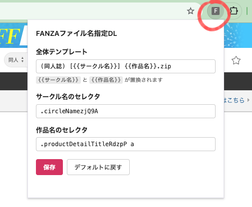

# FANZA ファイル名指定ダウンロード（Chrome拡張）

FANZAの購入済み作品ページで、作品をダウンロードする際に自動でファイル名を付与するChrome拡張機能です。

FANZAのダウンロードファイル名は `d_123456.zip` のような作品IDのため、後から作品を探す時に非常に面倒です。
本拡張を導入すると、ダウンロード時にサークル名・作品名から以下の形式のファイル名が自動生成されます。

```
(同人誌) [サークル名] 作品名.zip
```

ファイル名の形式は設定画面から自由に変更できます。

## 動作環境

- Chrome（Manifest V3）
- 対象ページ: `https://www.dmm.co.jp/dc/-/mylibrary/detail/*`

## インストール方法

1. 最新版を[このリポジトリのReleases](https://github.com/da2el-ai/fanza-dl-name/releases)からダウンロード
   - Assets の中の `fanza-dl-name-x.y.z.zip` を選んでください
2. ダウンロードした ZIP ファイルを解凍する
   - **解凍先は後から削除・移動しない場所を選んでください**（後述）
3. Chrome で `chrome://extensions` を開く
4. 右上の「デベロッパーモード」をオンにする
5. 「パッケージ化されていない拡張機能を読み込む」をクリックし、解凍した `fanza-dl-name` フォルダを選択
   - または解凍したフォルダをウィンドウにドラッグ・ドロップ
   - Windows の「すべて展開」を使うと `fanza-dl-name-x.y.z` フォルダの中に `fanza-dl-name` フォルダができます。
     読み込むのは**内側の `fanza-dl-name`**（`manifest.json` が直接入っているフォルダ）です

### 解凍先フォルダについての注意

デベロッパーモードで読み込んだ拡張機能は、コピーではなく**解凍したフォルダをそのまま参照し続けます**。そのため以下の点にご注意ください。

- フォルダを削除・ゴミ箱へ移動すると、拡張機能が動作しなくなります
- ダウンロードフォルダやデスクトップなど、後で整理してしまいがちな場所は避けてください
- フォルダを別の場所へ移動した場合も読み込めなくなります。移動したら改めて読み込み直してください

また、拡張機能の識別にはフォルダの**パス**が使われます。
別の場所へ移動して読み込み直すと Chrome からは別の拡張機能として扱われるため、設定した内容は引き継がれません。

## 更新方法

1. Releases から新しいバージョンの ZIP をダウンロードし、**今使っているフォルダとは別の場所**で解凍する
2. 解凍してできた `fanza-dl-name` フォルダの**中身**を、今読み込んでいるフォルダに上書きコピーする
3. `chrome://extensions` で本拡張の更新ボタン（🔄）を押す

拡張機能はフォルダのパスで識別されるため、パスが変わると設定が引き継がれません。
フォルダ自体は移動したり作り直したりせず、**中身だけを入れ替えて**ください。

> 今使っているフォルダと同じ場所で ZIP を解凍すると、上書きされずに
> `fanza-dl-name 2` のような別名のフォルダが作られてしまいます（macOS の場合）。
> 更新したつもりで古いバージョンが動き続けることになるため、必ず別の場所で解凍してください。

## 使い方

1. FANZA にログインし、購入済み作品ページを開きます
   - 例: `https://www.dmm.co.jp/dc/-/mylibrary/detail/...`
2. ダウンロードボタンをクリックします
3. 設定したテンプレートの形式でファイルが保存されます

ダウンロードは Chrome 標準のダウンロード機能で行われるため、
進捗表示（ダウンロードバブル・`chrome://downloads`）は通常どおり機能します。

## 設定

拡張機能のアイコンをクリックすると設定画面が開きます。



| 設定項目 | デフォルト値 | 説明 |
| --- | --- | --- |
| 全体テンプレート | `(同人誌) [{{サークル名}}] {{作品名}}.zip` | `{{サークル名}}` と `{{作品名}}` が置換されます |
| サークル名のセレクタ | `.circleNamezjQ9A` | サークル名を取得する `querySelector` |
| 作品名のセレクタ | `.productDetailTitleRdzpP a` | 作品名を取得する `querySelector` |

- 設定は Chrome アカウントに同期して保存されます
- 空欄のまま保存するとデフォルト値に戻ります
- 「デフォルトに戻す」を押すと入力欄にデフォルト値が入ります（反映するには「保存」を押してください）

## 注意事項

- ファイル名に使用できない文字（`\ / : * ? " < > |`）は自動的に除去されます
- セレクタで要素が見つからない場合は「不明サークル」「不明タイトル」が使われます
- FANZA のページ構造が変更された場合は、設定画面からセレクタを修正することで対応できます
- 同名のファイルが既にある場合は、連番を付けて保存されます
- 制作者は同人誌のダウンロードページしか動作確認していません。
- 他のコンテンツで動作しない場合は設定のセレクタを各自で変更してください。HTMLが理解できる方なら devtool で探せると思います。

## ライセンス

MIT
